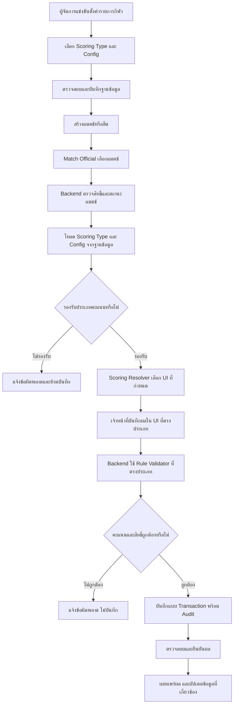

# TECHED SPORT — Scoring Architecture & Dynamic Recording UI (V2)

> **สถานะเอกสาร:** ข้อกำหนดออกแบบ / แผน Refactor เพื่อให้ Coding Agent สำรวจ Codebase จริงก่อนลงมือ  
> **ระบบ:** ระบบประชาสัมพันธ์และรายงานผลการแข่งขันกีฬา (TECHED SPORT)  
> **เทคโนโลยีปัจจุบันที่ต้องรักษา:** PHP, JavaScript, SQL Database, Tailwind CSS  
> **ขอบเขต:** ตั้งค่าประเภทการบันทึกผลในทัวร์นาเมนต์ → บันทึกฐานข้อมูล → เลือกแมตช์ → เปิด UI ตามประเภท **โดยบังคับ** → ตรวจสอบและบันทึกผล → ยืนยัน/เผยแพร่

## 1. เป้าหมายที่ห้ามคลาดเคลื่อน

1. **ผู้จัดการแข่งขัน** เลือกประเภทการบันทึกคะแนน/ผล (`scoring_type`) และกติกา (`scoring_config`) เมื่อเพิ่มรายการกีฬา/ประเภทการแข่งขันในทัวร์นาเมนต์ โดยระบบเสนอค่าเริ่มต้นที่เหมาะกับกีฬาให้เลือกปรับและยืนยันได้
2. เก็บค่าในฐานข้อมูล ณ ระดับ **รายการแข่งขันย่อย (tournament event / division)** ไม่ผูกแบบตายตัวกับ `sports` เพราะกีฬาเดียวกันอาจจัดหลายประเภท/กติกา เช่น แบดมินตันเดี่ยว–คู่, เทนนิส, การแข่งระดับต่าง ๆ
3. เมื่อ **Match Official** เลือกแมตช์ ระบบอ่านค่าจากฐานข้อมูลที่เชื่อถือได้ ตรวจสิทธิ์ แล้ว **เปิด UI ของประเภทนั้นอัตโนมัติ**; ผู้บันทึกผลไม่มีตัวเลือกเปลี่ยน `scoring_type`
4. Backend ต้องตรวจสอบ `scoring_type`/กติกาที่ผูกกับแมตช์ทุกครั้งที่รับคำสั่งบันทึกคะแนน **ห้ามเชื่อชนิดคะแนนที่ส่งจาก Browser**; ใช้ Rule Validator ของประเภทนั้น
5. **แยกไฟล์และหน้าที่** ออกจาก `index.php` / `AppService.php` โดยทยอย Refactor แบบไม่เปลี่ยนพฤติกรรมเดิมก่อน แล้วจึงเพิ่มความสามารถใหม่ทีละส่วน
6. เก็บผลการแข่งขันย้อนหลัง คะแนนที่ยืนยันแล้ว Audit Log และสิทธิ์เดิมให้ถูกต้อง; ไม่มีการเปลี่ยน Schema/ข้อมูลจริงโดยไม่มีแผน Migration และการทดสอบ
7. **ไม่สร้าง 1 Page ต่อ 1 กีฬา**: ใช้ UI Template ตามรูปแบบข้อมูล/คะแนน และใช้ Rule Config รายกีฬา; บางกีฬาต้องเป็น Composite/Specialized Template

## 2. ขอบเขตของระบบและคำจำกัดความ

- **Sport**: ชื่อชนิดกีฬา เช่น ฟุตบอล แบดมินตัน บาสเกตบอล
- **Tournament**: งานแข่งขันใหญ่ เช่น กีฬาคณะประจำปี
- **Event/Division**: รายการแข่งย่อยที่มีผู้เข้าร่วมและกติกาเฉพาะ เช่น แบดมินตันชายเดี่ยว, ฟุตบอลชาย, วิ่ง 100 เมตรหญิง
- **Scoring Type**: แบบจำลองที่กำหนดว่าเก็บข้อมูลผลอย่างไร เช่น `SET_SCORE`, `RACE_TIME`
- **Scoring Config**: ข้อกำหนด เช่น จำนวนเซต คะแนนเป้าหมาย ช่วงเวลา วิธีเรียงอันดับ การเสมอ รูปแบบการต่อเวลา
- **Match/Heat/Round**: หน่วยการแข่งขันจริง; กีฬาจับเวลาและกีฬาลานอาจมีผู้แข่งมากกว่า 2 คน **ห้ามสมมติว่าทุกแมตช์มีสองทีม**
- **Recorder UI Template**: ฟอร์ม/จอที่ผู้บันทึกเห็นตาม Scoring Type
- **Rules / Validators**: ตรวจความถูกต้องและคำนวณผล; **UI ไม่ใช่แหล่งตัดสินผลลัพธ์ที่เชื่อถือได้**
- **Outcome/Result Status**: ชนะ–แพ้–เสมอ, ยกเลิก, ไม่มาร่วม, DQ, DNF, DNS, WALKOVER เป็นต้น เป็นข้อมูลผลลัพธ์หรือสถานะแยกจากการนับคะแนนตามความเหมาะสม

**หมายเหตุ:** รหัส `scoring_type` ต่อไปนี้เป็นข้อเสนอเชิงออกแบบสำหรับโปรเจค ไม่ใช่มาตรฐานการตั้งชื่อที่สหพันธ์กีฬาทุกชนิดรับรองร่วมกัน

## 3. Catalog: รูปแบบบันทึกผล 21 ประเภท

| # | Scoring Type | ภาษาไทย | ตัวอย่างการนำไปใช้ | กลุ่ม UI ที่แนะนำ |
|---:|---|---|---|---|
| 1 | `SCORE` | คะแนนรวมสองฝ่าย | ฟุตบอล, ฟุตซอล, แฮนด์บอล | `TeamScoreView` |
| 2 | `SET_SCORE` | แต้มแยกตามเซต | แบดมินตัน, วอลเลย์บอล, เทเบิลเทนนิส | `SetScoreView` |
| 3 | `PERIOD_SCORE` | คะแนนตามควอเตอร์/ช่วงเวลา | บาสเกตบอล, ฮอกกี้น้ำแข็ง | `SegmentScoreView` |
| 4 | `ROUND_SCORE` | คะแนนแยกตามยก/รอบ | มวยที่ใช้คะแนนยก, กีฬาแข่งขันแบบหลายยก | `SegmentScoreView`/`JudgingView` ตามกติกา |
| 5 | `TARGET_SCORE` | คะแนนสะสมถึงเป้าหมาย | เปตอง, เกมแข่งขันที่จบเมื่อถึงแต้ม | `TeamScoreView` + กติกาเป้าหมาย |
| 6 | `RACE_TIME` | เวลาแข่งขัน | วิ่ง, ว่ายน้ำ, ปั่นจักรยานแบบจับเวลา | `RaceResultView` |
| 7 | `RACE_POSITION` | ลำดับเข้าเส้นชัย | การแข่งขันที่ตัดสินจากลำดับเข้าเส้นชัย | `RaceResultView` |
| 8 | `DISTANCE` | ระยะทาง/ระยะที่ทำได้ | กระโดดไกล, ทุ่มน้ำหนัก, ขว้างจักร | `MeasurementView` |
| 9 | `HEIGHT` | ความสูงและจำนวนครั้งที่ทำได้ | กระโดดสูง, กระโดดค้ำถ่อ | `MeasurementView` แบบความสูง/attempt |
| 10 | `JUDGE_SCORE` | คะแนนจากกรรมการ | ยิมนาสติก, กระโดดน้ำ | `JudgingView` |
| 11 | `POINTS_ACCUMULATION` | คะแนนสะสมหลายรอบ | ยิงธนูบางรูปแบบ, ยิงปืน, โบว์ลิ่งบางระบบ | `AccumulationView` |
| 12 | `WIN_LOSS` | ผลชนะ–เสมอ–แพ้ | หมากรุกบางรายการ, แมตช์ตัดสินผล | `MatchOutcomeView` |
| 13 | `INNINGS_SCORE` | คะแนนตามอินนิ่ง | เบสบอล, ซอฟต์บอล | `SegmentScoreView` แบบอินนิ่ง |
| 14 | `MAP_SCORE` | ผลแพ้ชนะตามเกม/แผนที่ | อีสปอร์ตแบบหลายแผนที่ | `SetScoreView`/`MapScoreView` |
| 15 | `AGGREGATE_SCORE` | ผลรวมหลายเลก/หลายแมตช์ | ฟุตบอลเหย้า–เยือนบางรายการ | `AggregateView` |
| 16 | `GAME_SET_MATCH` | แต้ม → เกม → เซต → แมตช์ | เทนนิส | `TennisScoreView` (เฉพาะทาง) |
| 17 | `STROKE_SCORE` | จำนวนสโตรก | กอล์ฟแบบ Stroke Play | `StrokeScoreView` |
| 18 | `COUNTDOWN_SCORE` | คะแนนนับถอยหลัง | ดาร์ต 501 | `CountdownView` |
| 19 | `WEIGHT_RESULT` | น้ำหนัก/ครั้งที่ยกได้ | ยกน้ำหนัก | `MeasurementView` แบบ attempt |
| 20 | `COMBINED_EVENT` | ผลรวมหลายประเภทการแข่งขัน | ทศกรีฑา | `CombinedEventView` |
| 21 | `DECISION_RESULT` | ผลจากคำตัดสิน | มวยชนะน็อก, ชนะคะแนน, Walkover | `MatchOutcomeView` + รายละเอียดคำตัดสิน |

**ข้อควรระวังในการใช้ Catalog:**
- กีฬาหนึ่งชนิดอาจใช้ **มากกว่าหนึ่งโมเดลหรือโมเดลประกอบ** เช่น เทนนิสไม่ใช่เพียงเซตธรรมดา, เปตองอาจบันทึกคะแนนรายเอนด์, การแข่งขันยิงธนูมีกติกาต่างกันตามชนิดรายการ
- `WIN_LOSS`, `DECISION_RESULT` และ `RACE_POSITION` ในบางบริบทเป็น **การบันทึกผลลัพธ์** ไม่ใช่คะแนนต่อเหตุการณ์ ต้องแยกสถานะผลจากกติกานับคะแนนให้ชัด
- `AGGREGATE_SCORE` และ `COMBINED_EVENT` เป็นการ **รวบรวมผลข้ามแมตช์/ประเภท** มักใช้ร่วมกับ Scoring Type ขั้นต้นอีกชั้นหนึ่ง
- บาสเกตบอลใช้ช่วงเวลาและคะแนนรวม; ฟุตบอลอาจต่อเวลา/จุดโทษ: กติกาเฉพาะเป็น Config ไม่ควรสร้าง `scoring_type` ใหม่ทุกกรณี
- Catalog ไม่ใช่คำสั่งให้สร้าง UI/Rule 21 ชุดทันที: ให้ตรวจประเภทที่มีจริงและใช้งานจริงก่อน แล้วค่อยขยายตามการทดสอบ

## 4. ตัวอย่างตั้งค่าในขั้นสร้างทัวร์นาเมนต์

**UI ของผู้จัดการแข่งขัน:**

1. เลือกทัวร์นาเมนต์และเพิ่มรายการกีฬา เช่น `แบดมินตัน / ชายเดี่ยว`
2. ระบบแนะนำ `SET_SCORE` จาก Preset ของกีฬา (แนะนำ **ไม่บังคับ** ที่หน้าตั้งค่า)
3. ผู้จัดเลือกหรือยืนยัน Scoring Type ที่ระบบรองรับ
4. ระบบแสดงช่องกติกาเฉพาะ เช่น best-of, target points, lead by, cap, tie-break ตามชนิดกีฬา/รายการ
5. กด **บันทึกการตั้งค่า** → ตรวจ Config → บันทึกฐานข้อมูล
6. ผู้จัดสร้างสาย/แมตช์หรือฮีต; ทุกหน่วยการแข่งขันอ้างอิง Config ของ Event ที่กำหนด
7. ก่อนแมตช์เริ่ม/เมื่อเริ่มมีคะแนน ให้ **ล็อกหรือ Snapshot การตั้งค่ากติกา** เพื่อรักษาประวัติผลเดิม

**กฎสำคัญ:** รายการที่มีผลบันทึกแล้วห้ามเปลี่ยน Scoring Type หรือ Config ย้อนหลังโดยตรง ต้องมีกระบวนการแก้ไขที่ตรวจสอบผลกระทบ/สิทธิ์/ประวัติได้

## 5. Flow: Match Official เลือกแมตช์แล้วระบบเลือก UI บังคับ



- **ห้ามให้ผู้บันทึกเลือก Scoring Type ในหน้าแมตช์** แม้จะเปลี่ยนค่าใน URL หรือ Request ก็ต้องไม่เปลี่ยน Rule หรือ View
- ถ้าระบบใช้หน้าเดียวเป็น container สามารถ Render partial สำหรับประเภทนั้นได้; ไม่จำเป็นต้องเปลี่ยน URL หรือเพิ่ม Route แยกทุกชนิด
- หากไม่พบ Type หรือ Config ให้หยุดการบันทึกและแสดงข้อผิดพลาด ไม่ fallback ไป `SCORE`
- ควรแสดงประเภทคะแนนเป็นข้อความอ่านง่าย เช่น “แบบเซต” แทนค่าภายใน `SET_SCORE`

## 6. UI Templates: ใช้ร่วมได้ แต่ต้องมีส่วนเฉพาะ

| UI Template | ประเภทที่รองรับเชิงแนวคิด | จุดควรระวัง |
|---|---|---|
| `TeamScoreView` | `SCORE`, `TARGET_SCORE` | กติกาเป้าหมาย/เสมอ/ช่วงเวลาไม่เหมือนกัน |
| `SetScoreView` | `SET_SCORE`, `MAP_SCORE` | Map กับ Set อาจต่างกันด้านผู้ชนะและผลย่อย |
| `SegmentScoreView` | `PERIOD_SCORE`, `ROUND_SCORE`, `INNINGS_SCORE` | คะแนนรายยก, รอบตัดสิน และอินนิ่งมีรายละเอียดต่างกัน |
| `RaceResultView` | `RACE_TIME`, `RACE_POSITION` | ต้องรองรับผู้แข่งหลายคน, DNF/DNS/DQ และ tie-breaking |
| `MeasurementView` | `DISTANCE`, `HEIGHT`, `WEIGHT_RESULT` | มี attempt, invalid/foul, best-of แตกต่างกัน |
| `JudgingView` | `JUDGE_SCORE`, `POINTS_ACCUMULATION` | สูตรรวมคะแนน/ตัดคะแนนสูงต่ำต่างกัน |
| `MatchOutcomeView` | `WIN_LOSS`, `DECISION_RESULT` | สถานะคำตัดสินและเหตุผลต้องครบ |
| **เฉพาะทาง/Composite** | `GAME_SET_MATCH`, `STROKE_SCORE`, `COUNTDOWN_SCORE`, `AGGREGATE_SCORE`, `COMBINED_EVENT` | **ห้าม** ฝืนใช้หน้าทั่วไปหากข้อมูล/Logic ไม่เพียงพอ |

วิธีสร้างโค้ด:
- **Shared Components**: `MatchHeader`, `StatusBadge`, `MatchActions`, `ConfirmDialog`, `ErrorBanner`
- **Separate UI/handlers** ตาม template เมื่อการโต้ตอบต่างกันจริง เช่น `set-recorder.js`, `race-recorder.js`
- **Rules** ควรแยกตามกลุ่ม/ประเภทที่มี Validation ต่างกัน; UI และ Backend ต้องอ้างอิง Type Mapping ที่เข้ากัน
- ใช้ **Tailwind CSS เดิม** สำหรับ Layout/สถานะต่าง ๆ ไม่รื้อ Design System

## 7. โครงสร้างไฟล์เป้าหมาย (ตัวอย่าง ไม่ใช่สั่งสร้างทั้งหมด)

```text
public/
  index.php                            # Router / Entry Point แบบบาง
  api.php                              # API Entry Point แบบบาง
  assets/js/scoring/
    match-selector.js
    score-recorder.js
    set-recorder.js
    segment-recorder.js
    race-recorder.js
    measurement-recorder.js
app/
  Modules/
    Tournaments/
      TournamentController.php
      TournamentService.php
      TournamentRepository.php
      Views/settings.php
    Matches/
      MatchController.php
      MatchService.php
      MatchRepository.php
    Scoring/
      ScoringController.php
      ScoringService.php
      ScoringRepository.php
      ScoringResolver.php
      ScoringConfigValidator.php
      Rules/                    # กฎเฉพาะประเภทที่ใช้งานจริง
        ScoreRule.php
        SetRule.php
        RaceRule.php
      Views/
        match-selector.php
        score.php
        set.php
        segment.php
        race.php
        measurement.php
        unsupported.php
      Partials/
        match-header.php
        match-actions.php
    News/                         # ไม่แก้ระหว่าง Refactor นี้
    Users/                        # ไม่แก้ระหว่าง Refactor นี้
  Core/
    Auth.php
    Database.php
    bootstrap.php
config/
  scoring-types.php                   # Allowlist/Registry จากโค้ดที่เชื่อถือได้
docs/
  SCORING_ARCHITECTURE_V2.md
```

- เส้นทาง/ชื่อไฟล์ต้องอิง Codebase จริง อย่าสร้าง Controller, Service, Repository ใหม่ซ้ำที่มีอยู่แล้ว
- `index.php` และ `api.php` ยังเป็น Entry Point เดิมได้ แต่ **ไม่ควรเก็บ View HTML ขนาดใหญ่หรือเงื่อนไขนับคะแนนทั้งหมดไว้ภายใน**
- ไม่ต้องแยกเป็นไฟล์ขนาดเล็กมากจนทำให้ต้องกระโดดอ่านโค้ดหลายไฟล์โดยไม่มีประโยชน์

## 8. ตัวอย่างการทำงานของ Resolver (Pseudo-Code)

```php
// Controller ต้องยืนยันตัวตนและตรวจ scope ก่อน
$match = $matchRepository->findForRecording($matchId);
$authorization->assertCanRecord($user, $match);

// ใช้ server-side configuration ที่ผูกกับแมตช์ ไม่เชื่อ scoring_type จาก Request
$type = $match->locked_scoring_type ?? $match->event_scoring_type;
$config = $match->locked_scoring_config ?? $match->event_scoring_config;

$resolved = $scoringResolver->resolve($type, $config); // allowlist + validate
return $renderer->render($resolved->view, [
    'match' => $match,
    'config' => $config,
]);
```

**ตัวอย่างเพื่ออธิบาย Flow เท่านั้น:** ไม่ใช่โค้ดคัดลอกใช้งานได้ทันที โครงสร้าง property/schema ต้องตรวจจากฐานข้อมูลจริง

เมื่อ Submit คะแนน:
1. ตรวจ Session + CSRF + Permission ของ `match_id`
2. อ่าน `scoring_type` ที่ผูกกับแมตช์จาก DB **อีกครั้ง**
3. ใช้ Rule/Validator ตาม Type → ตรวจคะแนนที่ส่งและสถานะ
4. บันทึก Transaction/locking ตามความจำเป็น (ป้องกันบันทึกแข่งกันและผลซ้ำ)
5. เก็บผู้แก้ไข เวลา และประวัติการเปลี่ยนแปลง / idempotency ตาม workflow จริง
6. ส่ง Response ตาม API Contract เดิม

## 9. แผนข้อมูล (ข้อเสนอเท่านั้น ต้องเทียบ Schema จริงก่อน)

```text
sports
  id, name, ...

tournaments
  id, name, ...

tournament_events
  id, tournament_id, sport_id, division, scoring_type,
  scoring_config_json, scoring_config_version, ...

matches_or_heats
  id, event_id, status, ...

match_participants
  match_id, participant_id, lane_or_side_or_order, ...

match_scoring_snapshots (ถ้าจำเป็น)
  match_id, scoring_type, scoring_config_json, version, locked_at

match_results / score_events
  match_id, structured_payload, status, updated_by, updated_at, ...

score_audit_logs
  match_id, actor_id, action, before, after, timestamp, reason, ...
```

หลักการ:
- แยก `scoring_type` ออกจาก `scoring_config` เพื่อใช้ UI ร่วมกันแต่เปลี่ยนกติกาได้
- ใช้รายละเอียดคะแนนแบบมีโครงสร้างที่ **validate ได้ตาม type**; สำหรับการสืบค้น/ตารางคะแนน อาจต้องมีฟิลด์สรุปเป็นคอลัมน์ด้วย ไม่ใช่ใส่ทุกอย่างเป็น JSON โดยไม่ออกแบบ Query
- รองรับผู้แข่งขันมากกว่า 2 ราย (`match_participants`) ตามข้อกำหนดของแต่ละชนิด
- ผลการแข่งขันที่รับรองแล้วเป็นข้อมูลควบคุม; การแก้ไขต้องมีสิทธิ์เฉพาะและ Audit Trail
- **ห้าม Migration อัตโนมัติโดยเดา type ของข้อมูลเก่า**; ต้องทำ Backfill Map และตรวจสอบ
- อย่าเพิ่มตารางซ้ำกับตารางที่ระบบเดิมรองรับอยู่แล้ว

## 10. กฎสถานะและการแก้ไข Config

- `DRAFT`: ตั้งค่าประเภทคะแนน/กติกาได้
- `READY`: ตรวจความพร้อมก่อนเปิดการแข่งขัน; การแก้ Config ต้องประเมินผลกระทบต่อแมตช์ที่จัดไว้แล้ว
- `IN_PROGRESS`: ล็อกการตั้งค่าหลักของแมตช์ที่กำลังแข่งขัน; ห้ามเปลี่ยน Type กลางแมตช์
- `COMPLETED`: ยืนยันผลแล้ว; การแก้ไขผลต้องได้รับสิทธิ์และเก็บ Audit

**หมายเหตุ:** ชื่อสถานะจริงของระบบอาจต่างกัน ให้ Mapping กับของเดิม ไม่เปลี่ยนค่าเดิมโดยไม่มี Migration และ Regression Test

## 11. แผน Refactor แบบลดความเสี่ยง

| ระยะ | สิ่งที่ทำ | สิ่งที่ยังไม่ทำ | Exit Criteria |
|---|---|---|---|
| 0. Audit | สำรวจ Router, AppService, API, DB, Views/JS, scoring เดิม, Git state | ยังไม่แก้ระบบ | มี Dependency Map + Test Baseline |
| 1. Extract Views | ย้าย HTML/Page Scoring เป็น partial/module | ไม่แก้คะแนน/DB | หน้าจอเดิม Render และทำงานได้ |
| 2. Extract Handlers | แยก JS ตามการบันทึกแต่ละแบบ | ไม่เปลี่ยน Event Contract | คะแนนยังบันทึก/โหลดได้เหมือนเดิม |
| 3. Extract Services | ย้าย Scoring Logic จาก AppService เป็น Service/Rule | ไม่เพิ่มประเภทกติกาใหม่ | Regression Tests ผ่าน, API เดิมไม่เปลี่ยน |
| 4. Config Audit | ตรวจว่าสคีมามี scoring_type/config ระดับ Event หรือยัง | ไม่ Migration โปรดักชันโดยพลการ | Data Map + Migration Plan |
| 5. Resolver | ให้ Backend อ่าน Type จาก DB เลือก View/Rule | ยังไม่ทำ 21 ประเภทครบ | Existing Types ถูกบังคับเปิด UI ถูกต้อง |
| 6. Expand | เพิ่ม Type/UI/Rule ตามกีฬาที่ใช้จริง | ไม่สร้างทั้งหมดรวดเดียว | Test Per Type + Backward Compatibility |

การเปลี่ยนหนึ่งระยะต้องเป็น Commit แยกและมีขั้นตอน Rollback ได้; ทดสอบกับฐานข้อมูลสำเนาก่อนเปลี่ยน Schema

## 12. Test Matrix ขั้นต่ำ

- สร้างรายการกีฬาใหม่และยืนยัน `scoring_type` + `scoring_config` ได้
- โหลดการตั้งค่ารายการเดิมได้ตรงกับข้อมูลที่บันทึกไว้
- เลือกแมตช์ `SCORE` → เปิดหน้าคะแนนรวม; `SET_SCORE` → เปิดหน้าเซต; `RACE_TIME` → เปิดหน้าจับเวลา; `RACE_POSITION` → เปิดหน้าอันดับ
- ความแตกต่างระหว่างการแข่งสองทีมกับฮีตหลายผู้เข้าร่วมแสดง UI ถูกต้อง
- เปลี่ยน `scoring_type` ใน URL/API ด้วยตนเอง → **Backend ไม่ยอมให้บันทึกข้าม Type**
- ผู้ใช้ไม่มีสิทธิ์ของแมตช์ → ไม่สามารถดูหน้าบันทึก/ส่งคะแนนได้
- Type ไม่รองรับหรือ Config เสีย → แจ้ง error ไม่ fallback
- คะแนนจาก API ที่ผิดกติกาถูกปฏิเสธ
- การบันทึก/Refresh/แก้ไข/ยืนยันผลยังทำงานได้เหมือนเดิมสำหรับประเภทที่มีอยู่แล้ว
- Scoring Config ของแมตช์ที่เริ่มแล้วไม่เปลี่ยนเมื่อผู้จัดไปแก้ Event
- สอง Request พร้อมกันไม่ทำให้คะแนนถูกเขียนทับโดยไม่มีการป้องกัน
- Dashboard ข่าวสาร ผลการแข่งขัน และ Tournament Bracket ยังใช้งานได้เหมือนเดิม
- ไม่มี PHP/JS error ใหม่; Tailwind UI เดิมไม่เสียหาย
- ข้อมูลแมตช์และผลเก่าไม่สูญหายจากการย้ายโมดูล

## 13. ข้อห้ามสำหรับ Coding Agent

- ห้าม Rewrite โปรเจคทั้งหมดหรือย้ายไป Framework ใหม่โดยไม่ถูกสั่ง
- ห้ามเปลี่ยน API Contract, Authentication, Permission หรือ Database Schema ระหว่างงาน **Extract/Refactor เฉพาะโครงสร้าง**
- ห้ามแก้ข่าวสาร/ระบบผู้ดูแล/หน้าอื่นนอกขอบเขต เว้นแต่เป็น Dependency จำเป็นที่ระบุให้ตรวจสอบ
- ห้ามลบ/Reset/Force checkout การเปลี่ยนแปลงของผู้ใช้, ห้ามแตะ Secrets
- ห้ามใช้ Mock Data แทนข้อมูลจริงเพื่อให้หน้าดูเหมือนทำงาน
- ห้ามให้ Recorder เลือกหรือปลอม `scoring_type`
- ห้ามกำหนด `SCORE` เป็นค่า fallback เมื่อ Type ไม่รู้จัก
- ห้ามอ้างว่าทดสอบผ่านถ้ายังไม่รันทดสอบจริง
- ห้ามเพิ่มกติกา 21 ชนิดในคำสั่งเดียวก่อนตรวจระบบเดิม

## 14. เงื่อนไขการส่งมอบจาก AI

ทุก Phase ให้รายงานอย่างกระชับ:
1. ไฟล์ที่อ่านและ Dependency สำคัญ
2. ไฟล์ที่เพิ่ม/แก้ พร้อมเหตุผล
3. API/Schema/Behavior ที่คงเดิมและสิ่งที่เปลี่ยนจริง
4. Test Command และผลการรัน (ผ่าน/ไม่ผ่าน/ยังไม่รัน)
5. ความเสี่ยง การย้อนกลับ และ Phase ถัดไป

**หลักยึด:** แยกโค้ดเพื่อให้แก้ง่ายและประหยัดบริบท AI แต่ต้องรักษาความถูกต้องของคะแนนและข้อมูลประวัติการแข่งขันเป็นอันดับแรก
