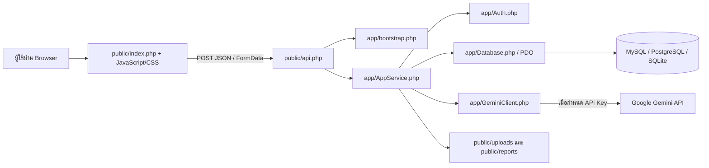
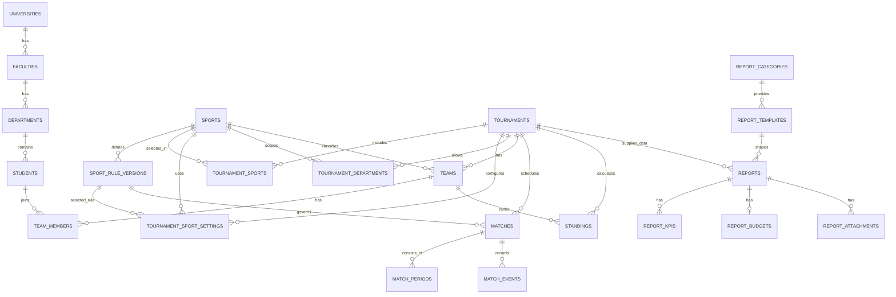
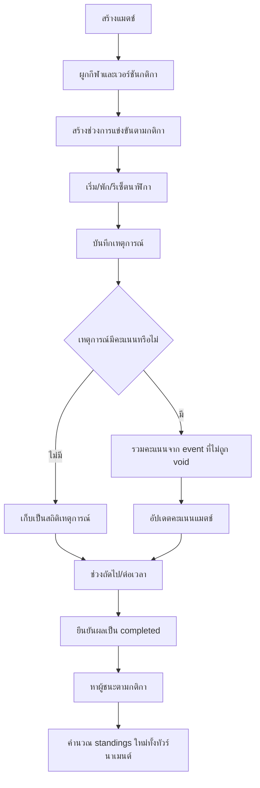

# โครงสร้างระบบและลำดับการทำงานของ TECHED SPORT

> เอกสารฉบับนี้อธิบายภาพรวมจากโค้ดปัจจุบันในโปรเจกต์ `prsport` ครอบคลุมสถาปัตยกรรม โครงสร้างไฟล์ โมดูล ฐานข้อมูล สิทธิ์ผู้ใช้ ลำดับการทำงาน และจุดเชื่อมต่อภายนอก

## 1. สรุปภาพรวมระบบ

TECHED SPORT หรือ RMUTT Sports MVP เป็นเว็บแอปสำหรับบริหารงานกีฬา ตั้งแต่การตั้งค่าข้อมูลหลัก การสร้างทัวร์นาเมนต์หลายกีฬา การนำเข้าข้อมูลนักศึกษา การจัดทีมและสมาชิก การจัดตารางแข่งขัน การบันทึกเหตุการณ์และผลการแข่งขัน การคำนวณตารางอันดับ การประชาสัมพันธ์ข่าว การติดตามงาน ตลอดจนการจัดทำรายงานและช่วยร่างเนื้อหาด้วย AI

> **ขอบเขตสำคัญ:** ระบบนี้ไม่มีขั้นตอนเปิดรับสมัคร นักศึกษา นักกีฬา ทีม และสมาชิกทีมทั้งหมดเป็นข้อมูลที่เจ้าหน้าที่นำเข้าหรือจัดการจากหลังบ้านภายในทัวร์นาเมนต์

ระบบใช้สถาปัตยกรรมแบบเว็บแอปขนาดเล็กที่ไม่พึ่ง PHP framework โดยแบ่งหน้าที่หลักเป็น 4 ชั้น:

1. **Presentation layer** — หน้า HTML/PHP, CSS และ JavaScript ใน `public/`
2. **API/Controller layer** — รับคำขอและตอบ JSON ผ่าน `public/api.php`
3. **Service layer** — API dispatch และ shared use cases อยู่ใน `app/AppService.php`; ฟีเจอร์ทัวร์นาเมนต์แยกใน `app/Modules/TournamentModule.php`
4. **Data layer** — เชื่อมต่อฐานข้อมูลและสร้าง schema/seed ผ่าน `app/Database.php` และ `database/`

ระบบมีลักษณะเป็น Single Page Application แบบเบา ๆ: PHP สร้างหน้าเริ่มต้นหนึ่งหน้า จากนั้น JavaScript สลับ view และเรียก API ด้วย `fetch()` โดยไม่ต้องโหลดหน้าใหม่ทุกครั้ง



## 2. เทคโนโลยีที่ใช้

| ส่วน | เทคโนโลยี/แนวทาง |
|---|---|
| Backend | PHP 8.x แบบ `strict_types`, class-based service และ PDO |
| Frontend | HTML5, CSS, Vanilla JavaScript |
| UI icon | Lucide แบบไฟล์ local |
| Banner | HTML Canvas ผ่าน `banner-studio.js` |
| ฐานข้อมูล | MySQL เป็นค่าเริ่มต้น, PostgreSQL สำหรับ Render/Supabase และ SQLite เมื่อระบุ DSN เช่นในการทดสอบ |
| AI | Google Gemini REST API และ `local-summary` fallback |
| Session | PHP session เก็บใน `storage/sessions/` |
| Testing | Playwright smoke test ผ่าน Node.js |
| Deployment | Apache/XAMPP หรือ Docker บน Render เชื่อม Supabase PostgreSQL |

โปรเจกต์ไม่มี Composer และไม่มี JavaScript framework; dependency ฝั่ง Node ใช้เฉพาะ Lucide และ Playwright สำหรับทดสอบ UI

## 3. โครงสร้างไดเรกทอรีและหน้าที่

```text
prsport/
├─ index.php                     จุดเข้าหน้าเว็บจาก root; ส่งต่อไป public/index.php
├─ api.php                       จุดเข้า API จาก root; ส่งต่อไป public/api.php
├─ deploy-check.php              ตรวจสอบความพร้อมขณะ deploy
├─ server-check.php              ตรวจสอบสภาพแวดล้อมของ server
├─ Dockerfile                    PHP 8.3 + Apache + PDO MySQL/PostgreSQL
├─ render.yaml                   ค่าบริการสำหรับ Render
├─ package.json                  คำสั่ง smoke test และ dependency ฝั่ง Node
├─ app/
│  ├─ bootstrap.php              โหลด .env, timezone, autoload, session และฐานข้อมูล
│  ├─ Database.php               สร้าง PDO, migrate, seed และ bootstrap admin
│  ├─ Auth.php                   login/logout/session/role/CSRF
│  ├─ AppService.php             API dispatch, shared helpers และ use cases หลัก
│  ├─ Modules/TournamentModule.php  เมธอดทัวร์นาเมนต์ที่แยกเป็น feature module
│  └─ GeminiClient.php           ติดต่อ Gemini API, timeout, proxy และ diagnostics
├─ database/
│  ├─ schema.sql                 schema สำหรับ SQLite
│  ├─ schema.mysql.sql           schema สำหรับ MySQL
│  ├─ schema.pgsql.sql           schema สำหรับ PostgreSQL
│  ├─ seed.sql                   seed สำหรับ SQLite
│  ├─ seed.mysql.sql             seed สำหรับ MySQL
│  └─ seed.pgsql.sql             seed สำหรับ PostgreSQL
├─ public/
│  ├─ index.php                  หน้า UI ทั้งสาธารณะและหลังบ้าน
│  ├─ pages/tournaments/         หน้ารายการ สร้าง และ Dashboard ทัวร์นาเมนต์
│  ├─ components/tournaments/    ฟอร์มทัวร์นาเมนต์ร่วม
│  ├─ api.php                    API controller และ error mapping
│  ├─ assets/
│  │  ├─ app.js                 state, navigation, forms และ API client
│  │  ├─ workspace.js           behavior ของ workspace/UI
│  │  ├─ modules/tournaments.js  navigation, Wizard สร้าง และข้อมูลทัวร์นาเมนต์
│  │  ├─ modules/tournaments.css layout หน้าทัวร์นาเมนต์
│  │  ├─ banner-studio.js       เครื่องมือออกแบบแบนเนอร์บน Canvas
│  │  ├─ app.css                style หลัก
│  │  ├─ workspace.css          style ส่วน workspace
│  │  ├─ lucide.min.js          icon library แบบ local
│  │  └─ logo/font/image assets
│  ├─ uploads/                   โลโก้ รูปข่าว และไฟล์แนบที่อัปโหลด
│  └─ reports/                   ไฟล์รายงานที่ export
├─ storage/
│  ├─ sessions/                  PHP session files
│  └─ ui-checks/                 ภาพหรือผลจาก UI smoke test
├─ tools/
│  └─ ui-smoke.cjs              Playwright smoke test
└─ docs/                         เอกสารการใช้งาน การ deploy และ AI
```

## 4. ลำดับการเริ่มระบบ

ทุกครั้งที่เปิดหน้าเว็บหรือเรียก API จะเริ่มจาก `app/bootstrap.php` ตามลำดับนี้:

1. กำหนด path หลัก ได้แก่ root, app, public, database, storage และ uploads
2. อ่าน `.env` โดยไม่เขียนทับ environment variable ที่มีอยู่แล้ว
3. ตั้ง timezone จาก `PRSPORT_TIMEZONE` หรือใช้ `Asia/Bangkok`
4. ลงทะเบียน autoloader สำหรับ class ใน `app/`
5. สร้าง `storage/sessions/` หากยังไม่มี
6. เริ่ม PHP session ชื่อ `prsport_session` พร้อม `HttpOnly` และ `SameSite=Lax`
7. เรียก `Database::boot()` เพื่อเชื่อมต่อฐานข้อมูล
8. เลือก schema และ seed ให้ตรงกับ driver
9. สร้างตาราง/คอลัมน์/index ที่จำเป็นแบบ idempotent
10. เติมข้อมูล seed และ backfill โครงสร้างการแข่งขันรุ่นใหม่
11. หากตาราง `users` ยังว่าง สร้างผู้ดูแลเริ่มต้นจาก environment หรือค่าเริ่มต้น

ลำดับเลือกการเชื่อมต่อฐานข้อมูลคือ:

1. `PRSPORT_DB_DSN`
2. `DATABASE_URL`, `POSTGRES_URL` หรือ `SUPABASE_DB_URL`
3. ชุด `DB_HOST`, `DB_PORT`, `DB_DATABASE`, `DB_USERNAME`, `DB_PASSWORD`
4. ค่าเริ่มต้น MySQL ที่ `127.0.0.1:3306/prsport`

เมื่อเป็น PostgreSQL URL ระบบจะแปลง URL เป็น PDO DSN และอ่าน `sslmode`; เมื่อเป็น MySQL ระบบพยายามสร้าง database ให้ถ้าบัญชีมีสิทธิ์

## 5. ลำดับคำขอหน้าเว็บ

### 5.1 เปิดหน้าเว็บ

1. Browser เรียก `index.php`
2. root `index.php` include `public/index.php`
3. `public/index.php` include bootstrap
4. Server อ่าน settings, ผู้ใช้ปัจจุบัน และ CSRF token
5. PHP render HTML พร้อมตัวแปร `window.PRSPORT` ซึ่งมี:
   - URL ของ API
   - CSRF token
   - ข้อมูลผู้ใช้ปัจจุบันที่ตัด password ออกแล้ว
6. Browser โหลด `lucide.min.js`, `workspace.js`, `banner-studio.js` และ `app.js`
7. เมื่อ `DOMContentLoaded` ทำงาน ระบบเริ่ม workspace, banner studio, navigation, auth, forms และปรับเมนูตาม role
8. JavaScript โหลดข้อมูลของ view ที่เปิดอยู่ผ่าน API

### 5.2 เรียก API

1. `app.js` เรียก `request(action, payload)`
2. ส่ง `POST` ไป `api.php?action=<action>` เป็น JSON
3. แนบ header `X-CSRF-Token`
4. `public/api.php` เรียก bootstrap และอ่าน action
5. สำหรับคำขอที่แก้ไขข้อมูล ระบบตรวจ CSRF ยกเว้น login, preview invite และ accept invite
6. รวมข้อมูลจาก JSON body และ `$_POST`
7. ส่งต่อไป `AppService::handle(action, payload, files)`
8. `AppService` ตรวจสิทธิ์ ตรวจข้อมูล และทำงานกับฐานข้อมูล/ไฟล์/AI
9. สำเร็จตอบ `{ "ok": true, "data": ... }`
10. ข้อมูลไม่ถูกต้องตอบ HTTP 422, ปัญหาธุรกิจตอบ 400, ไม่มีสิทธิ์ตอบ 403 และข้อผิดพลาดไม่คาดคิดตอบ 500

## 6. ส่วนติดต่อผู้ใช้

### 6.1 หน้าสาธารณะ

ผู้เยี่ยมชมไม่ต้องเข้าสู่ระบบ สามารถดู:

- หน้าแรกและข้อมูลสรุป
- รายการกีฬา
- รายชื่อนักกีฬา/ทีมที่เผยแพร่
- ตารางแข่งขัน
- ผลการแข่งขันและตารางอันดับ
- ข่าวที่เผยแพร่
- Hall of Fame/ข้อมูลผลงานที่ระบบจัดเตรียม

ข้อมูลสาธารณะถูกจำกัดตามสถานะ เช่น ข่าวต้องเป็น `published` และข้อมูลการแข่งขันจะแยกตารางที่กำลังจะมาถึงออกจากผลที่จบแล้ว

### 6.2 หน้าหลังบ้าน

หลังเข้าสู่ระบบ JavaScript จะแสดงเมนูตาม role ได้แก่:

- Dashboard
- ตั้งค่าข้อมูลหลัก
- แยกหน้ารายการ สร้างแบบร่าง และจัดการทัวร์นาเมนต์ โดยเข้าถึงกีฬา ทีม ตาราง และผลได้อิสระ
- ข่าวสารและ Banner Studio
- แผนงาน
- ผู้ดูแลระบบ
- รายงาน

การซ่อนเมนูเป็นเพียงชั้น UX; การอนุญาตจริงตรวจซ้ำใน Backend ทุก action

## 7. บทบาทและสิทธิ์

| Role | หน้าที่หลัก |
|---|---|
| `super_admin` | จัดการได้ทุกส่วน รวมผู้ใช้ เผยแพร่/ลบรายงาน |
| `admin` | เจ้าหน้าที่กลาง จัดการข้อมูลหลัก งานทะเบียนนักกีฬา ผู้ใช้ และงานส่วนใหญ่ |
| `sport_head` | จัดการรายการแข่งขัน ทีม แมตช์ ผล และงานด้านกีฬา |
| `result_officer` | บันทึกเวลา เหตุการณ์ คะแนน และผลการแข่งขัน |
| `public_relations` | จัดการข่าว แบนเนอร์ งาน และรายงาน |
| `viewer` | ดู dashboard และรายงาน แต่แก้ไขไม่ได้ |
| `guest` | ดูเฉพาะข้อมูลสาธารณะ |

กลุ่มสิทธิ์ที่ Backend ใช้:

- จัดการผู้ใช้/ข้อมูลหลัก: `super_admin`, `admin`
- จัดการข้อมูลนักศึกษาและทีมภายใน: `super_admin`, `admin`
- จัดการกีฬา/รายการแข่งขัน: `super_admin`, `admin`, `sport_head`
- บันทึกผล: `super_admin`, `admin`, `sport_head`, `result_officer`
- จัดการข่าว: `super_admin`, `admin`, `public_relations`
- ดูรายงาน: ผู้ใช้ทุก role ยกเว้น `guest`
- แก้รายงาน: ทุก role ที่ login ยกเว้น `viewer`
- เผยแพร่หรือลบรายงาน: `super_admin`, `admin`
- งาน/Tasks: เจ้าหน้าที่ทุก role ยกเว้น `viewer`

## 8. โมดูลของระบบ

| โมดูล | ความสามารถหลัก | ตารางสำคัญ |
|---|---|---|
| Settings/Organization | ค่าระบบ มหาวิทยาลัย คณะ สาขา โลโก้ | `settings`, `universities`, `faculties`, `departments` |
| Users/Auth | ผู้ใช้ role profile invitation และ session | `users`, `user_invites` |
| Sports | ชนิดกีฬา จำนวนผู้เล่น กติกาและเวอร์ชันกติกา | `sports`, `sport_rule_versions` |
| Student Import | ข้อมูลนักศึกษา คุณสมบัติ และนำเข้า CSV โดยเจ้าหน้าที่ ไม่มีระบบสมัคร | `students` |
| Tournament Workspace | เวิร์กโฟลว์ทัวร์นาเมนต์หลายกีฬา กติกาเฉพาะรายการ สาขาที่เข้าร่วม ทีม และสมาชิก | `tournaments`, `tournament_sports`, `tournament_sport_settings`, `tournament_departments`, `teams`, `team_members` |
| Match Center | ตารางแข่ง เวลา ช่วงแข่งขัน เหตุการณ์ คะแนน ผู้ชนะ | `matches`, `match_periods`, `match_events` |
| Standings | แข่ง ชนะ เสมอ แพ้ ได้ เสีย คะแนน และอันดับ | `standings` |
| News | ข่าว สถานะ ปักหมุด รูปปก และการเชื่อม entity | `news`, `news_links` |
| Tasks | งาน ผู้รับผิดชอบ กำหนดส่ง ลำดับความสำคัญ | `tasks` |
| Reports | ประเภท template เนื้อหา KPI งบ และเอกสารแนบ | `report_categories`, `report_templates`, `reports`, `report_kpis`, `report_budgets`, `report_attachments` |
| Audit | ประวัติการเปลี่ยนข้อมูลสำคัญ | `audit_logs` |
| AI | สรุป dashboard/system, ร่างข่าว และร่างรายงาน | ใช้ข้อมูลจากหลายตารางโดยไม่เก็บ secret ลง dataset |

## 9. ความสัมพันธ์ของข้อมูลหลัก



จุดสำคัญของแบบจำลองข้อมูล:

- รายการแข่งขันหนึ่งรายการรองรับหลายกีฬา โดย `tournament_sports` เป็นตารางเชื่อม และ `tournaments.sport_id` ยังคงเป็นกีฬาหลักเพื่อรองรับข้อมูลเดิม
- `tournament_sport_settings` กำหนดเวอร์ชันกติกา สถานะความพร้อม และหมายเหตุแยกตามกีฬาในแต่ละทัวร์นาเมนต์
- `tournament_departments` กำหนดสาขาที่เข้าร่วมแยกตามกีฬา ทำให้ทีมต้องอยู่ในขอบเขตที่ทัวร์นาเมนต์กำหนด
- ทีมผูกกับทั้งรายการแข่งขัน สาขา และกีฬา
- แมตช์ผูกกับเวอร์ชันกติกา ทำให้ผลการแข่งขันเดิมยังอ้างอิงกติกาที่ใช้ตอนสร้างแมตช์
- คะแนนสามารถบันทึกโดยตรงตอนปิดผล หรือคำนวณจาก `match_events`
- ตารางอันดับถูกสร้างใหม่จากแมตช์สถานะ `completed` เพื่อป้องกันค่าค้าง
- เนื้อหารายงานบางส่วนเก็บเป็น JSON เพื่อให้ template หลายรูปแบบใช้ schema เดียวกันได้

## 10. ลำดับการทำงานหลักแบบ End-to-End

### 10.1 การตั้งค่าระบบครั้งแรก

1. กำหนด `.env` และฐานข้อมูล
2. เปิดระบบครั้งแรก
3. Bootstrap สร้าง schema และ seed
4. Seed ข้อมูล settings, สาขา กีฬาเริ่มต้น ข่าวต้อนรับ และแม่แบบรายงาน
5. สร้างมหาวิทยาลัย/คณะและ backfill ความสัมพันธ์ที่จำเป็น
6. สร้างกติกามาตรฐานให้กีฬาที่เดิมยังไม่มีกติกา
7. สร้างบัญชี `super_admin` หากยังไม่มีผู้ใช้
8. ผู้ดูแลเข้าสู่ระบบและเปลี่ยนข้อมูลบัญชี/รหัสผ่านตามการใช้งานจริง

### 10.2 การเข้าสู่ระบบ

1. ผู้ใช้กรอกอีเมลและรหัสผ่าน
2. `auth.login` ตรวจรูปแบบอีเมลและค้นหาผู้ใช้ที่เปิดใช้งาน
3. ตรวจรหัสผ่านด้วย `password_verify()`
4. Regenerate session ID เพื่อลด session fixation
5. เก็บ `user_id` ใน session
6. บันทึก audit log ของการ login
7. ส่ง user ที่ตัด hash/salt ออกและ CSRF token กลับไป
8. Frontend แสดงเมนูตาม role

กรณีบัญชีเก่าที่ยังไม่มี `password_hash` ระบบจะตั้ง hash จากรหัสผ่านครั้งแรกหลังตรวจความยาวขั้นต่ำ 8 ตัวอักษร

### 10.3 การเชิญผู้ใช้ใหม่

1. Admin ระบุอีเมล ชื่อ role สาขา/กีฬาที่รับผิดชอบ และอายุคำเชิญ
2. ระบบสร้าง token แบบสุ่ม แต่เก็บเฉพาะ hash ในฐานข้อมูล
3. ระบบคืน invitation URL ให้ Admin ส่งต่อ
4. ผู้รับเปิดลิงก์; `invites.preview` ตรวจ token, สถานะ และวันหมดอายุ
5. ผู้รับตั้งรหัสผ่านและยืนยันข้อมูลผ่าน `invites.accept`
6. ระบบสร้างหรือผูกบัญชีผู้ใช้ เปลี่ยนคำเชิญเป็น `accepted` และบันทึกเวลา

### 10.4 หน้ารายการ สร้าง และจัดการทัวร์นาเมนต์

เมนู **จัดการทัวร์นาเมนต์** เปิดหน้ารายการทั้งหมดก่อน ตารางแสดงชื่อ ปี/รุ่น จำนวนกีฬา จำนวนทีม และสถานะการแข่งขัน โดยปี/รุ่นไม่ตัดบรรทัดและชื่อกีฬาทั้งหมดไม่ถูกรวมในเซลล์เดียว

- **หน้ารายการ** — `public/pages/tournaments/TournamentList.php` ค้นหา/กรองรายการ แล้วกดจัดการหรือแก้ไข
- **หน้าสร้าง** — `TournamentCreate.php` ใช้ Wizard เฉพาะการสร้าง 3 ส่วน: ข้อมูลรายการ, เลือกกีฬา, รูปแบบและยืนยัน บันทึกผ่าน `tournaments.save` เดิมเป็น `draft` แล้วเข้าหน้าจัดการของรายการที่สร้างทันที
- **หน้าจัดการ** — `TournamentDashboard.php` เปิดภาพรวม กีฬาและกติกา นักกีฬา ทีมและสมาชิก ตารางแข่งขัน และผลการแข่งขันได้โดยตรง ไม่มี Sidebar ขั้นตอนซ้อนกับเมนูหลัก
- **ฟอร์มร่วม** — `public/components/tournaments/TournamentForm.php` ใช้ฟอร์มเดียวในการสร้างและแก้ไข โดยใช้ editor/modal และตารางค้นหากลางใน `workspace.js` ตามเดิม
- **โมดูลหน้าเว็บ** — `public/assets/modules/tournaments.js` ดูแล navigation, Wizard, การแสดงความพร้อม และการเรียก API ส่วน `tournaments.css` ดูแล layout
- **โมดูล Backend** — `app/Modules/TournamentModule.php` แยก 17 เมธอดออกจาก `AppService.php` โดยคงเนื้อหาของเมธอดเดิม และประกอบผ่าน PHP trait ทำให้ API, การตรวจสิทธิ์, validation, การจัดสาย และ audit เดิมยังทำงานผ่าน `AppService` เช่นเดิม

URL หน้าจัดการใช้ `?view=matches&tournament=<id>&section=<section>` รองรับการรีโหลดและประวัติเบราว์เซอร์ ส่วนหน้าสร้างใช้ `?view=matches&create=1`

สถานะแยกเป็น 3 ส่วน:

1. **การตั้งค่ารายการ** — อ่านความพร้อมกติกา/ทีม/สมาชิกจาก `tournaments.workspace` เดิม ไม่ใช้จำนวนขั้นที่รวมข่าว
2. **สถานะการแข่งขัน** — อ่าน `tournament.status` โดยตรง สถานะจบการแข่งขันไม่ถูกตีความว่าการตั้งค่าหรือข่าวครบ
3. **การเผยแพร่ผล** — แสดงตามจำนวนแมตช์ที่จบและเงื่อนไขหน้า public เดิม: รายการ `draft`/`cancelled` ไม่แสดงผลสาธารณะ ไม่มีการเพิ่มสถานะเผยแพร่ใหม่ในฐานข้อมูล

ประชาสัมพันธ์ใช้เมนูข่าวสารหลัก ไม่มีขั้นที่ 11 หรือปุ่มข่าวซ้ำในทัวร์นาเมนต์ การตรวจเงื่อนไขก่อนสร้างสายและบันทึกผลยังตัดสินโดย API เดิม ปุ่มสร้างสายแจ้งข้อจำกัดเดิมที่ทราบล่วงหน้า เช่น ยังไม่เลือกกีฬา ทีมไม่พอ หรือมีแมตช์แล้ว

สถานะทัวร์นาเมนต์คือ `draft` → `data_entry` → `ready` → `in_progress` → `completed` (หรือ `cancelled`) ค่าเดิม `registration`/`closed` ยังคงรองรับ และยังป้องกันการลบกีฬาที่มีการใช้งานหรือทัวร์นาเมนต์ที่มีทีม/แมตช์

### 10.5 การนำเข้าข้อมูลนักศึกษาและสมาชิกทีม

1. Frontend อ่าน CSV และแปลงเป็น array
2. ส่งข้อมูลให้ action นำเข้า
3. Backend ตรวจหัวข้อมูล รหัสนักศึกษา สาขา และข้อมูลซ้ำ
4. บันทึกเฉพาะรายการที่ผ่าน validation
5. คืนจำนวนสำเร็จและข้อผิดพลาดรายแถว
6. Frontend แสดงสรุปผลการนำเข้า

ค่าระบบ `max_sports_per_athlete` ใช้ควบคุมจำนวนกีฬาสูงสุดที่นักศึกษาหนึ่งคนสามารถเป็นนักกีฬาได้ ทั้งหมดเป็นการจัดการโดยเจ้าหน้าที่ภายใน ไม่ใช่การสมัครของนักศึกษา

### 10.6 การแข่งขันสดและบันทึกผล



รายละเอียด:

1. เมื่อเปิด Match Center ระบบโหลดแมตช์ กติกา ช่วงแข่งขัน เหตุการณ์ และสมาชิกของทั้งสองทีม
2. หากยังไม่มีช่วงการแข่งขัน ระบบสร้างจาก `period_format` ของกติกา
3. คำสั่งนาฬิการองรับ `start`, `pause`, `reset`, `next_period` และ `overtime`
4. เหตุการณ์ต้องเป็นชนิดที่เปิดไว้ในกติกา
5. ทีมต้องอยู่ในแมตช์ และหากเลือกนักศึกษา นักศึกษาต้องอยู่ในทีมนั้น
6. เมื่อเพิ่มหรือ void เหตุการณ์ ระบบรวม `points` ของ event ที่ไม่ถูก void แล้ว sync คะแนน
7. เมื่อบันทึกผลโดยตรง ระบบตรวจคะแนนทั้งสองฝั่งและหาผู้ชนะตาม `win_by`
8. หากคะแนนเท่ากันแต่กติกาไม่อนุญาตให้เสมอ ต้องระบุผู้ชนะจาก tie-break
9. เมื่อแมตช์จบ ระบบคำนวณอันดับใหม่

การจัดอันดับเรียงตาม:

1. คะแนนรวม
2. ผลต่างคะแนนได้-เสีย
3. คะแนนที่ทำได้
4. ID ทีมเพื่อให้ลำดับคงที่เมื่อทุกค่าเท่ากัน

คะแนนชนะ/เสมอ/แพ้อ่านจากกติกาของแต่ละแมตช์ โดยค่ามาตรฐานคือ 3/1/0

### 10.7 ข่าวและประชาสัมพันธ์

1. เจ้าหน้าที่เลือกกีฬา รายการแข่งขัน หรือแมตช์เป็นแหล่งข้อมูล
2. สามารถเขียนข่าวเอง หรือเรียก `ai.news` เพื่อสร้างร่าง
3. AI ได้รับข้อเท็จจริงจากระบบ เช่น ทีม คะแนน เวลา และผลการแข่งขัน
4. ระบบคืนหัวข้อ คำโปรย เนื้อหา และข้อความสั้นสำหรับแบนเนอร์
5. Banner Studio วาดภาพบน Canvas เลือก template สี รูปภาพ และตำแหน่งข้อความ
6. ดาวน์โหลด PNG หรืออัปโหลดเพื่อใช้เป็นรูปปกข่าว
7. บันทึกข่าวเป็น `draft`, `published` หรือ `archived`
8. ข่าวที่ publish จะปรากฏในหน้าสาธารณะ และข่าวปักหมุดถูกจัดลำดับก่อน

### 10.8 แผนงาน

1. สร้างงานพร้อมหมวด ความสำคัญ กำหนดส่ง และผู้รับผิดชอบ
2. สถานะเคลื่อนระหว่าง `todo`, `doing`, `blocked`, `done`
3. เมื่อเป็น `done` ระบบบันทึก `completed_at`; เมื่อเปิดใหม่จะล้างค่านี้
4. งานเกินกำหนดถูกคำนวณเพื่อแสดงบน task board และ dashboard
5. ทุกการสร้าง แก้สถานะ และลบมี audit log

### 10.9 รายงานแบบฟอร์ม

1. ผู้ใช้เลือกหมวดรายงาน
2. เลือก template ซึ่งกำหนด section ที่ต้องแสดง
3. กรอกข้อมูลทั่วไป การดำเนินงาน ผลลัพธ์ ปัญหา KPI และงบประมาณ
4. อาจเลือกทัวร์นาเมนต์เพื่อดึงทีม นักกีฬา และผลการแข่งขันมาเป็นข้อมูลอ้างอิง
5. อาจเรียก AI เพื่อช่วยร่างฟอร์ม; ถ้า Gemini ไม่พร้อมจะใช้ local fallback
6. บันทึก `reports`, `report_kpis` และ `report_budgets` ภายใน transaction เดียว
7. อัปโหลดหลักฐานเข้า `report_attachments`
8. สถานะรายงานเดินตาม `draft` → `review` → `completed` → `published`
9. เฉพาะ Admin/Super Admin เผยแพร่ แก้รายงานที่เผยแพร่แล้ว หรือลบรายงานได้
10. Export เป็นเอกสาร HTML ที่ Word เปิดได้และไฟล์ JSON สำหรับข้อมูลโครงสร้าง

### 10.10 รายงานสรุปอัตโนมัติและ AI

ระบบมีงาน AI หลักดังนี้:

- สรุป dashboard
- สรุปภาพรวมระบบ
- ตรวจ/ช่วยวิเคราะห์ข้อมูล CSV
- ร่างข่าวจากการแข่งขัน
- ร่างเนื้อหาแบบฟอร์มรายงาน
- สร้างรายงานทางการ

ลำดับทำงาน:

1. Service สร้าง dataset จากฐานข้อมูลโดยจำกัดจำนวนรายการ
2. ตัดข้อมูลอ่อนไหว เช่น password hash และข้อมูลบัตรดิบ
3. สร้าง system instruction ภาษาไทยและ prompt ตามงาน
4. ถ้ามี `GEMINI_API_KEY` ให้ `GeminiClient` เรียก `models.generateContent`
5. แปลงคำตอบเป็นโครงสร้าง JSON ที่ UI ใช้งานได้
6. หากไม่มี key หรือเรียก AI ไม่สำเร็จใน flow ที่รองรับ fallback ระบบสร้างสรุปจากกฎภายใน
7. ระบุ provider/model ในผลลัพธ์เพื่อให้ตรวจสอบแหล่งที่มาได้

## 11. การคำนวณและผลข้างเคียงสำคัญ

| เหตุการณ์ | ผลข้างเคียง |
|---|---|
| สร้างกีฬา | สร้างกติกามาตรฐานของกีฬานั้นด้วย |
| เปิด Match Center | ตรวจและสร้างช่วงการแข่งขันที่ยังขาด |
| เพิ่ม/void match event | คำนวณคะแนนจาก event ใหม่ |
| บันทึกผลแมตช์ | ตั้ง `completed`, หาผู้ชนะ และคำนวณ standings ใหม่ |
| ลบแมตช์ | ลบ period/event ที่เกี่ยวข้องและคำนวณ standings ใหม่ |
| ขอรายการ standings | คำนวณ standings ใหม่ก่อนตอบ |
| เปลี่ยน report status เป็น published | บันทึก `published_at` |
| เปลี่ยน task เป็น done | บันทึก `completed_at` |
| แก้ข้อมูลสำคัญ | เพิ่มรายการใน `audit_logs` |

## 12. ความปลอดภัยและความถูกต้องของข้อมูล

- Password เก็บด้วย `password_hash()` และตรวจด้วย `password_verify()`
- Session regenerate หลัง login/logout
- Cookie ของ session เป็น `HttpOnly` และ `SameSite=Lax`
- คำขอเขียนข้อมูลตรวจ CSRF token
- ทุกโมดูลตรวจ role ใน Backend
- PDO statement ใช้ parameter binding ใน query ที่รับค่าจากผู้ใช้
- User response ตัด `password_hash` และ `password_salt`
- Invite เก็บ hash ของ token แทน token จริง
- Upload ตรวจประเภท/รูปแบบและสร้างชื่อไฟล์ใหม่แบบสุ่ม
- Error ภายในไม่ส่ง stack trace ไป Browser แต่เขียนลง server log
- การบันทึกรายงานหลักกับ KPI/งบประมาณใช้ transaction
- การลบข้อมูลหลักหลายจุดมี dependency guard ก่อนลบ

ข้อควรทราบ: ค่า admin เริ่มต้น `admin@rmutt.local / Temp@1234` เหมาะสำหรับเครื่องพัฒนาเท่านั้น ควรกำหนด `PRSPORT_ADMIN_EMAIL` และ `PRSPORT_ADMIN_PASSWORD` ใหม่ก่อนใช้งานจริง และบัญชี bootstrap จะสร้างเฉพาะเมื่อไม่มีผู้ใช้ในตาราง

## 13. ไฟล์ที่ระบบสร้างระหว่างทำงาน

- `storage/sessions/` — session ของ PHP
- `public/uploads/logos/` — โลโก้ที่ upload เป็น data URL
- `public/uploads/news/` — รูปข่าว
- `public/uploads/reports/` หรือพื้นที่ upload ที่ service กำหนด — เอกสารแนบรายงาน
- `public/reports/` — HTML/Word-compatible document, JSON และผล export อื่นของรายงาน
- `storage/ui-checks/` — ภาพจาก Playwright smoke test

บน Render free filesystem ไฟล์เหล่านี้ไม่ถาวรและอาจหายเมื่อ redeploy/restart จึงควรย้ายไฟล์ upload/report ไป object storage หากใช้ production จริง

## 14. การทดสอบและตรวจสอบระบบ

### ตรวจ syntax ของ PHP

```powershell
php -l app/AppService.php
php -l app/Auth.php
php -l app/Database.php
php -l public/api.php
php -l public/index.php
```

### UI smoke test

```powershell
npm.cmd run test:ui
```

Smoke test จะเปิด PHP server ชั่วคราว ใช้ฐานข้อมูล SQLite แยก และเก็บภาพไว้ใน `storage/ui-checks/` เพื่อไม่กระทบฐานข้อมูลใช้งานจริง

### ตรวจ deployment

- `server-check.php` ตรวจ extension และ environment ของ PHP/server
- `deploy-check.php` ตรวจการเชื่อมฐานข้อมูลและจำนวนตาราง

## 15. การติดตั้งและ Deploy โดยย่อ

### XAMPP

1. วางโปรเจกต์ที่ `C:\xampp\htdocs\prsport`
2. สร้าง `.env` และกำหนดฐานข้อมูล
3. เปิด Apache และ MySQL
4. เข้า `http://localhost/prsport/`
5. Login ด้วยบัญชี admin ที่กำหนดไว้

### Render + Supabase

1. Render build จาก `Dockerfile`
2. Image เปิด Apache และติดตั้ง `pdo_mysql`, `pdo_pgsql`
3. ตั้ง `DATABASE_URL` ของ Supabase พร้อม `sslmode=require`
4. ตั้งค่า environment และ secret บน Render
5. เมื่อ container เริ่ม ระบบ migrate/seed โดยอัตโนมัติ
6. ตรวจผลผ่าน `server-check.php` และ `deploy-check.php`

## 16. ข้อสังเกตเชิงสถาปัตยกรรม

- เริ่มแยกฟีเจอร์ทัวร์นาเมนต์เป็น `TournamentModule` แล้ว โดย `AppService` คง API dispatch และ shared helpers เดิม ฟีเจอร์อื่นยังสามารถแยกตาม domain เพิ่มได้โดยทำเป็นงานเฉพาะและทดสอบแยก
- Migration ทำตอน bootstrap ทุก request แม้คำสั่งเป็น idempotent แต่ production ขนาดใหญ่ควรมี migration command แยกเพื่อลดภาระและควบคุม version
- การสร้าง ID หลายตารางใช้แนวทางหา ID ถัดไปใน application; หากมีผู้ใช้เขียนพร้อมกันจำนวนมากควรใช้ auto-increment/sequence ของฐานข้อมูล
- Standings ถูก rebuild เพื่อให้ผลถูกต้องและลดปัญหาค่าสะสมผิด แต่ต้นทุนเพิ่มตามจำนวนทีมและแมตช์
- UI และ Backend มีรายการสิทธิ์ทั้งสองฝั่ง ต้องรักษาให้ตรงกันเสมอ โดย Backend เป็นแหล่งตัดสินสุดท้าย
- การเก็บไฟล์ไว้ใต้ `public/` ทำให้เข้าถึงง่าย แต่ production ควรเพิ่มการตรวจ MIME, จำกัดขนาด, virus scanning และใช้ object storage
- Font Google ในหน้า UI ต้องใช้อินเทอร์เน็ต แต่รายงานมี Sarabun local เพื่อรองรับการพิมพ์

## 17. สรุป

ระบบ TECHED SPORT ครอบคลุมวงจรงานกีฬาตั้งแต่ **สร้างทัวร์นาเมนต์ → เลือกหลายกีฬา → ตั้งกติกาและสาขาแยกตามกีฬา → นำเข้าข้อมูลนักศึกษา → จัดทีมและสมาชิก → ตรวจความพร้อม → จัดตาราง → บันทึกผลและอันดับ → เผยแพร่ข่าวและรายงาน** โดยไม่มีขั้นตอนสมัครแข่งขัน

แกนกลางของระบบคือ `AppService.php` ซึ่งรับ action จาก API ตรวจสิทธิ์ผ่าน `Auth.php` และทำงานกับ PDO ผ่าน `Database.php` ส่วนหน้าเว็บใช้ JavaScript จัดการ state และเรียก API แบบ asynchronous ระบบรองรับหลายฐานข้อมูล มี audit log, CSRF, role-based access control, report workflow และ AI ที่กลับไปใช้ local-summary ได้เมื่อ Gemini ไม่พร้อม

ลำดับใช้งานที่แนะนำที่สุดคือ:

1. ตั้งค่า environment องค์กร กีฬา และแม่แบบกติกา
2. เข้าเมนูจัดการทัวร์นาเมนต์และสร้างทัวร์นาเมนต์
3. บันทึกแบบร่างจาก Wizard สั้น แล้วเข้าหน้าจัดการรายการ
4. เลือกจัดการกีฬา ทีม ตารางแข่งขัน หรือผลได้โดยตรง; จัดทำข่าวผ่านเมนูข่าวสาร
5. ตรวจสอบความพร้อมก่อนสร้างตารางและเริ่มการแข่งขัน
6. บันทึกผล ตรวจอันดับ และเผยแพร่ข้อมูลเมื่อผ่านการตรวจแล้ว

เมื่อ deploy production ควรให้ความสำคัญกับการเปลี่ยนบัญชีเริ่มต้น การเก็บ secret นอก repository การสำรองฐานข้อมูล และการย้ายไฟล์ upload/report ไปพื้นที่จัดเก็บถาวร
