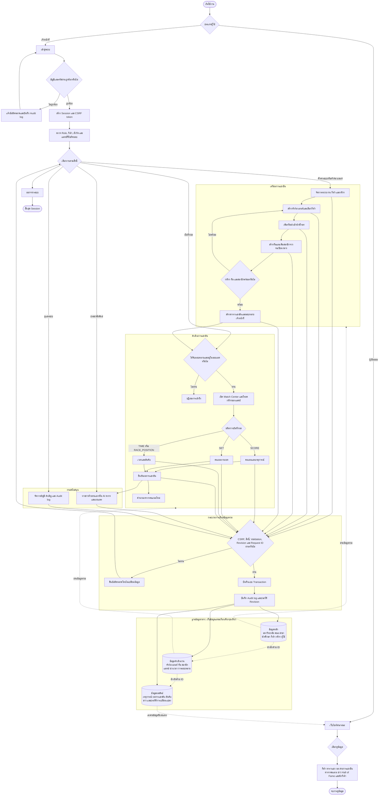

# Flowchart ระบบ TECHED SPORT แบบลดความซ้ำซ้อนของข้อมูล

เอกสารนี้สรุปกระบวนการหลักของระบบเป็นแผนภาพเดียว โดยรวมขั้นตอนตรวจสอบและการบันทึกที่ใช้ร่วมกันไว้จุดเดียว และกำหนดให้ข้อมูลแต่ละประเภทมีแหล่งอ้างอิงหลักเพียงแห่งเดียว (Single Source of Truth)

## หลักการลดความซ้ำซ้อนที่ใช้

1. เก็บนักศึกษาเพียงครั้งเดียวใน `students` แล้วเชื่อมทีมผ่าน `team_members` แทนการคัดลอกชื่อและสังกัดลงทุกทีม
2. เก็บกีฬาและเวอร์ชันกติกาใน `sports` และ `sport_rule_versions`; ทัวร์นาเมนต์เลือกใช้งานผ่านตารางเชื่อม และแมตช์ตรึง `rule_version_id`
3. เก็บทีมครั้งเดียวต่อทัวร์นาเมนต์ กีฬา และสังกัด แล้วให้แมตช์อ้างอิง `team1_id` และ `team2_id`
4. เก็บผลรวมของแมตช์หนึ่งรายการใน `match_results` เพียงระเบียนเดียว; การแก้ไขเก็บในตาราง revision โดยไม่สร้างผลซ้ำ
5. เก็บเหตุการณ์จริงใน `match_events`; คะแนนและตารางอันดับคำนวณจากข้อมูลที่ยืนยันแล้ว เพื่อลดค่าที่ค้างหรือขัดแย้งกัน
6. ข่าวเชื่อมแหล่งข้อมูลผ่าน `news_links` แทนการทำสำเนาข้อมูลแมตช์หรือทัวร์นาเมนต์ทั้งหมด
7. รวมการตรวจ CSRF, สิทธิ์, validation, revision และ request ID เป็น Write Gateway เดียวก่อนทุกการเปลี่ยนแปลงข้อมูล
8. หน้าเว็บไซต์สาธารณะอ่านจากข้อมูลกลางชุดเดียวกัน แต่แสดงเฉพาะข้อมูลที่มีสถานะเผยแพร่แล้ว

## สัญลักษณ์

- เส้นทึบ: ลำดับการทำงาน
- เส้นประ: การอ่านหรืออ้างอิงข้อมูล
- สี่เหลี่ยมข้าวหลามตัด: จุดตัดสินใจ
- ทรงกระบอก: กลุ่มข้อมูลในฐานข้อมูลกลาง

> หมายเหตุ: หน้าบันทึกผลเฉพาะทางในระบบปัจจุบันมีสำหรับ `SCORE` และ `SET`; ชนิด `TIME` และ `RACE_POSITION` ใช้กระบวนการรายการผู้เข้าแข่งขันและ API ที่เกี่ยวข้อง
