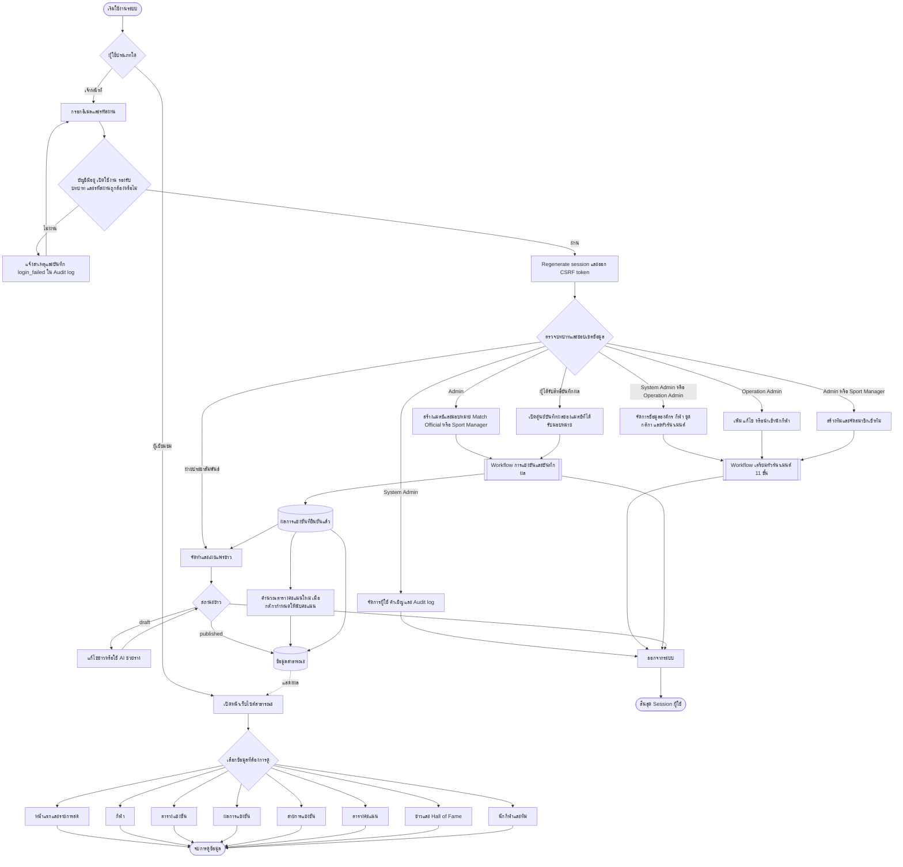
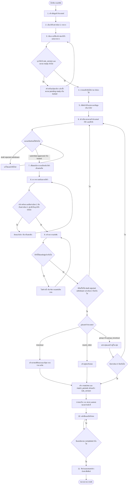
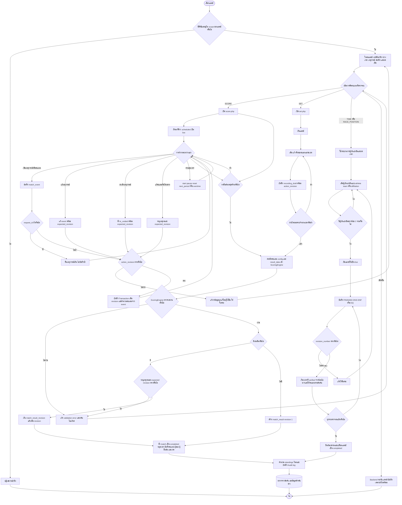
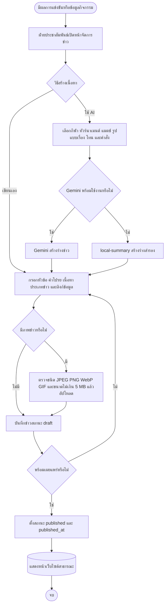
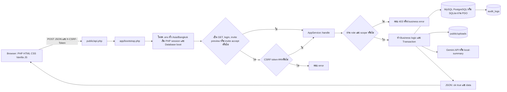
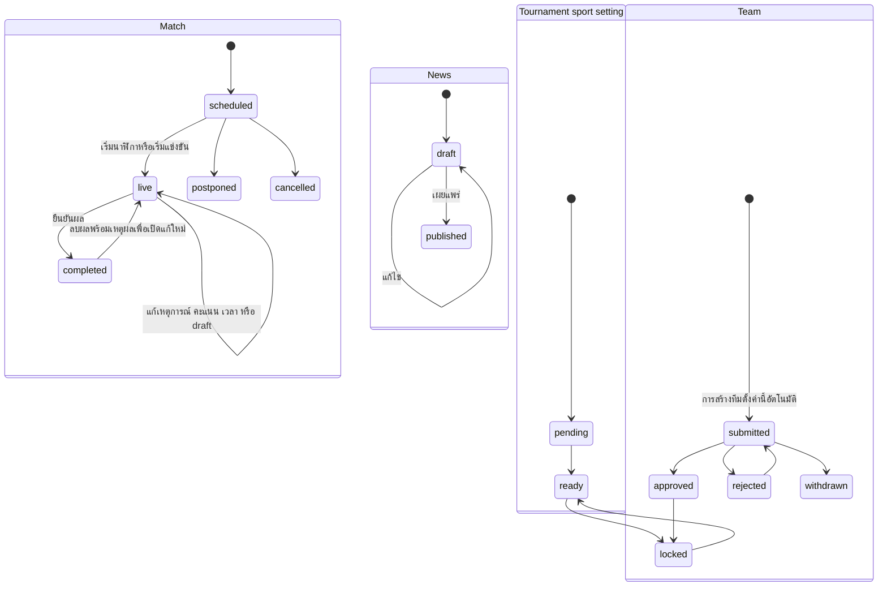
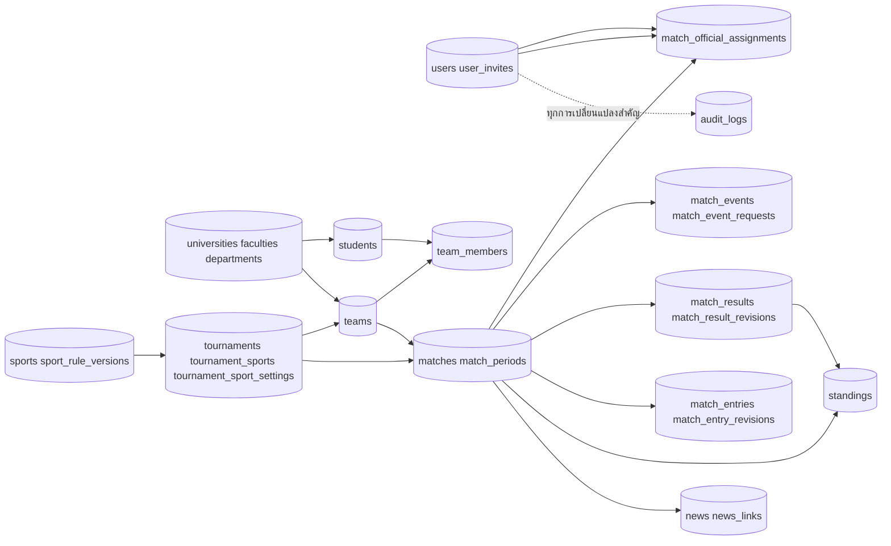

# ข้อกำหนด Flowchart ระบบ TECHED SPORT

> เอกสารนี้ถอดจากโค้ดปัจจุบันในโปรเจกต์ `prsport` ณ วันที่ 18 ตุลาคม 2026 เพื่อใช้เป็น source of truth สำหรับให้ AI หรือเครื่องมือวาดแผนภาพสร้าง Flowchart โดยไม่ต้องเดากระบวนการเพิ่มเอง

## 1. คำสั่งสำหรับ AI ที่นำเอกสารนี้ไปสร้างภาพ

สร้าง Flowchart ภาษาไทยของระบบ **TECHED SPORT** โดยยึด node, decision, actor, สถานะ และเส้นเชื่อมในเอกสารนี้อย่างเคร่งครัด

- ใช้ Swimlane แยกผู้ใช้งาน: ผู้เยี่ยมชม, System Admin, Operation Admin, Sport Manager, Match Official และฝ่ายประชาสัมพันธ์
- ใช้สัญลักษณ์วงรีสำหรับ Start/End, สี่เหลี่ยมสำหรับ Process, ข้าวหลามตัดสำหรับ Decision และทรงกระบอกสำหรับ Database
- เส้นทึบหมายถึงลำดับงาน เส้นประหมายถึงการอ่านข้อมูลหรือผลที่ถูกส่งไปแสดงต่อ
- แสดงเส้นทางผิดพลาดของ Login, CSRF, สิทธิ์, ข้อมูลไม่ครบ, revision conflict และ validation ไม่ผ่าน
- ห้ามเพิ่มขั้นตอนสมัครนักกีฬาด้วยตนเองหรือสมัครทีมจากหน้าสาธารณะ เพราะระบบไม่มีขั้นตอนดังกล่าว
- ห้ามวาดว่าทุกชนิดคะแนนมีหน้าบันทึกเฉพาะพร้อมใช้งาน ปัจจุบันหน้าเฉพาะมีเฉพาะ `SCORE` และ `SET`
- ถ้าสร้างภาพเดียว ให้ใช้หัวข้อ 3 เป็นแกนหลัก และยุบรายละเอียดจากหัวข้อ 4-8 เป็น subprocess

## 2. ขอบเขตและผู้มีส่วนร่วม

### 2.1 Actor และสิทธิ์หลัก

| Actor | รหัสบทบาท | ขอบเขตงานจริง |
|---|---|---|
| ผู้เยี่ยมชม | `guest` | ดูหน้าแรก กีฬา ตารางแข่งขัน ผลการแข่งขัน สายการแข่งขัน ตารางคะแนน ข่าว Hall of Fame และรายชื่อนักกีฬา/ทีมที่เผยแพร่ |
| System Admin | `super_admin` | จัดการได้ทุกส่วน รวมผู้ใช้ คำเชิญ และ Audit log |
| Operation Admin | `admin` | ข้อมูลกลาง กีฬา/กติกา ทัวร์นาเมนต์ นักกีฬา ทีม แมตช์ การมอบหมายผู้ตัดสิน ผล ข่าว และ AI แต่ไม่จัดการบัญชีผู้ใช้ |
| Sport Manager | `sport_head` | จัดการเฉพาะกีฬาและสังกัดในขอบเขตของตน จัดการทีม/สมาชิก และบันทึกผลเฉพาะแมตช์ที่ได้รับมอบหมาย |
| Match Official | `result_officer` | ดูและบันทึกผลเฉพาะแมตช์ที่ได้รับมอบหมาย รวมเวลา เหตุการณ์ คะแนน และผลจัดอันดับ |
| ฝ่ายประชาสัมพันธ์ | `public_relations` | สร้าง/แก้ไข/เผยแพร่ข่าว อัปโหลดภาพ และใช้ AI ช่วยร่างข่าวจากข้อมูลการแข่งขัน |

### 2.2 เงื่อนไขสิทธิ์ของการบันทึกผลแมตช์

`super_admin` และ `admin` จัดการผลได้ทุกแมตช์ ส่วน `result_officer` และ `sport_head` ต้องผ่านทุกเงื่อนไขที่เกี่ยวข้องดังนี้:

1. มีรายการมอบหมายใน `match_official_assignments`
2. กีฬาอยู่ใน `sport_ids` ของผู้ใช้ เมื่อบัญชีถูกจำกัดกีฬาหรือเป็น `sport_head`
3. ถ้ามอบหมายเจาะจงทีม ทีมดังกล่าวต้องเป็นหนึ่งในสองทีมของแมตช์
4. ถ้าบัญชีถูกจำกัด `department_code` ต้องตรงกับทีมที่ตนรับผิดชอบ

## 3. Master Flowchart ของระบบ

## 4. Flowchart การเตรียมทัวร์นาเมนต์ 11 ขั้น

### เกณฑ์ Progress ที่ระบบใช้จริง

| ขั้น | ถือว่าเสร็จเมื่อ |
|---|---|
| 1 | มีทัวร์นาเมนต์ที่เลือกอยู่ |
| 2 | ทัวร์นาเมนต์มีกีฬาอย่างน้อย 1 รายการ |
| 3 | ทุกกีฬามีชุดกติกาและ `setting_status = ready` |
| 4 | ถือว่าเสร็จเสมอ เพราะเป็นขั้นไม่บังคับ |
| 5 | มีนักกีฬาในระบบอย่างน้อย 1 คน ไม่ได้จำกัดเฉพาะทัวร์นาเมนต์ |
| 6 | มีทีมในทัวร์นาเมนต์อย่างน้อย 1 ทีม |
| 7 | มีสมาชิกทีมในทัวร์นาเมนต์อย่างน้อย 1 ราย |
| 8 | ทุกกีฬามีกติกาพร้อม และแต่ละกีฬามีทีมกับสมาชิกอย่างน้อย 1 ราย |
| 9 | มีแมตช์ในทัวร์นาเมนต์อย่างน้อย 1 แมตช์ |
| 10 | มีแมตช์สถานะ `completed` อย่างน้อย 1 แมตช์ |
| 11 | ในโค้ดปัจจุบันไม่ถูกตั้งเป็น complete อัตโนมัติ แม้จะมีข่าวแล้ว |

## 5. Flowchart การบันทึกผลการแข่งขัน

### ชนิดคะแนนที่ Backend รองรับ

| กลุ่ม | `scoring_type` | หลักตัดสินย่อ |
|---|---|---|
| คะแนนสองฝั่ง | `SCORE` | คะแนนรวมสูงกว่า; รองรับเสมอ ต่อเวลา และจุดโทษตาม config |
| คะแนนรายช่วง | `PERIOD_SCORE` | รวมคะแนนทุก period และเพิ่ม overtime เมื่อกติกาอนุญาต |
| แข่งเป็นเซต | `SET` | ชนะครบจำนวนเซตตาม `best_of` และตรวจ target/win-by |
| คะแนนรายรอบ/End | `ROUND`, `END_SCORE` | รวมคะแนนรายรอบ; END_SCORE ต้องถึงเป้าหมาย |
| เวลา/อันดับ | `TIME`, `RACE_POSITION` | ค่าน้อยกว่าชนะ; กระบวนการหลายผู้เข้าแข่งขันใช้ `match_entries` |
| ระยะ/ความสูง | `DISTANCE`, `HEIGHT` | ผลงานที่ดีที่สุด; ความสูงใช้จำนวนครั้งไม่ผ่านช่วยตัดสิน |
| กรรมการ/เป้า | `JUDGED`, `POINT_RANKING`, `TARGET` | รวม/เฉลี่ย/ตัดค่าสูงต่ำตาม config แล้วคะแนนสูงกว่าชนะ |
| จำนวน/ค่าน้อย | `COUNT`, `LOWEST` | สูงหรือต่ำกว่าชนะตามชนิดและ config |
| วิธีตัดสิน | `DECISION`, `COMBAT` | ผู้ชนะจากคะแนนหรือวิธี KO, TKO, Submission, DQ, Walkover เป็นต้น |
| หลายรายการ | `COMBINED` | รวมคะแนนถ่วงน้ำหนัก สูงหรือต่ำกว่าชนะตาม config |
| กอล์ฟ | `STROKE` | จำนวนสโตรกน้อยกว่าชนะ |
| อีสปอร์ต | `MAP` | ชนะจำนวน Map ถึงเกณฑ์ `best_of` |

> ข้อจำกัด UI ปัจจุบัน: `public/assets/app.js` ส่งผู้ใช้ไปหน้าบันทึกเฉพาะ `public/scoring/score.php` สำหรับ `SCORE` และ `public/scoring/set.php` สำหรับ `SET` เท่านั้น ชนิดอื่นมี service/engine รองรับแต่หน้า UI หลักแสดงข้อความว่ายังอยู่ระหว่างจัดทำ

## 6. Flowchart ข่าวและการเผยแพร่

## 7. Flowchart การรับคำขอของระบบ

### Error mapping ของ API

- `InvalidArgumentException` → HTTP 422
- `RuntimeException` ที่มีข้อความ “ไม่มีสิทธิ์” → HTTP 403
- `RuntimeException` อื่น → HTTP 400
- `Throwable` อื่น → HTTP 500 และไม่ส่งรายละเอียดภายในออกไป

## 8. สถานะสำคัญที่ควรแสดงในภาพ

## 9. Data flow และตารางฐานข้อมูลหลัก

## 10. กฎความถูกต้องที่ห้ามตัดออกจาก Flowchart

1. ทุกคำขอเขียนข้อมูลต้องมี CSRF token ยกเว้น Login และกระบวนการคำเชิญที่ระบุไว้
2. การสร้างแมตช์ตรึง `rule_version_id` เพื่อรักษากติกาประวัติของแมตช์นั้น
3. เมื่อเปลี่ยนกติกาประจำทัวร์นาเมนต์ ระบบย้ายกติกาให้เฉพาะแมตช์ `scheduled` ที่ยังไม่มี event และ result; แมตช์ live/completed ไม่ถูกเปลี่ยน
4. การสร้างสายอัตโนมัติไม่ทำงานถ้ากีฬานั้นมีแมตช์อยู่แล้ว
5. การบันทึกผลทั่วไปผ่าน `ScoringEngine` และสำเร็จแบบ transaction เท่านั้น
6. การแก้ผลที่มีอยู่ต้องระบุเหตุผลและ revision ต้องตรง เพื่อป้องกันเขียนทับกัน
7. การบันทึก action/event ใช้ `action_revision`; การสร้าง event ใช้ `request_id` ป้องกันคำขอซ้ำ
8. Event ที่ยกเลิกไม่ถูกลบทิ้ง แต่ตั้ง `is_voided` เพื่อเก็บประวัติ
9. การยืนยันผลทำให้แมตช์เป็น `completed`, หยุดนาฬิกา, บันทึกผู้ยืนยัน/เวลา และคำนวณ standings ใหม่
10. การลบผลเดิมต้องมีเหตุผล เก็บประวัติใน Audit log และเปิดแมตช์กลับเป็น `live`
11. ผลแบบเวลาใช้ `verified_time_ms` จัดอันดับจากน้อยไปมาก; DNS, DNF และ DQ ไม่มีอันดับ
12. ข่าวจะปรากฏต่อสาธารณะเมื่อสถานะเป็น `published` เท่านั้น

## 11. หมายเหตุความคลาดเคลื่อนระหว่าง UI และ Backend

- Backend อนุญาต `sport_head` ที่ได้รับมอบหมายให้บันทึกผล แต่ปุ่มลัดขั้นที่ 10 ใน Tournament Workflow ฝั่ง UI ระบุเฉพาะ `super_admin`, `admin` และ `result_officer`; Sport Manager ยังเข้าศูนย์ผลได้จากหน้าที่บทบาทตนมีสิทธิ์
- Backend รองรับชนิดคะแนนทั้งหมดในหัวข้อ 5 แต่ routing หน้าเว็บปัจจุบันมี dedicated recording page เฉพาะ `SCORE` และ `SET`
- ขั้นที่ 4 “สังกัดที่เข้าร่วม” ถูกอธิบายว่าไม่บังคับและ Progress ถือว่าเสร็จเสมอ แม้ API บันทึกสังกัดจะบังคับให้เลือกอย่างน้อย 1 สังกัดเมื่อผู้ใช้กดบันทึก
- Progress ขั้นที่ 11 ยังไม่มีเงื่อนไขตรวจข่าวที่เผยแพร่ จึงแสดงเป็นยังไม่เสร็จเสมอในข้อมูล workspace ปัจจุบัน

## 12. ไฟล์อ้างอิงจากโค้ด

- `public/index.php` — โครงหน้าเว็บสาธารณะและหลังบ้าน
- `public/assets/app.js` — navigation, role view, Tournament Workflow 11 ขั้น และ routing หน้าบันทึกผล
- `public/api.php` — API entry point และ error mapping
- `app/bootstrap.php` — environment, session, CSRF support และ database boot
- `app/Auth.php` — บทบาท Login และ permission helper
- `app/AppService.php` — use case, validation, transaction, scope และ Audit log
- `app/ScoringTypeDetector.php` — การเลือกชนิดคะแนนจากกติกาหรือชนิดกีฬา
- `app/ScoringEngine.php` — การตรวจและสรุปผลแต่ละชนิดคะแนน
- `public/scoring/score.php` และ `public/assets/scoring/score.js` — หน้าบันทึกคะแนน `SCORE`
- `public/scoring/set.php` และ `public/assets/scoring/set.js` — หน้าบันทึกคะแนน `SET`
- `database/schema.sql`, `database/schema.mysql.sql`, `database/schema.pgsql.sql` — schema ฐานข้อมูล
