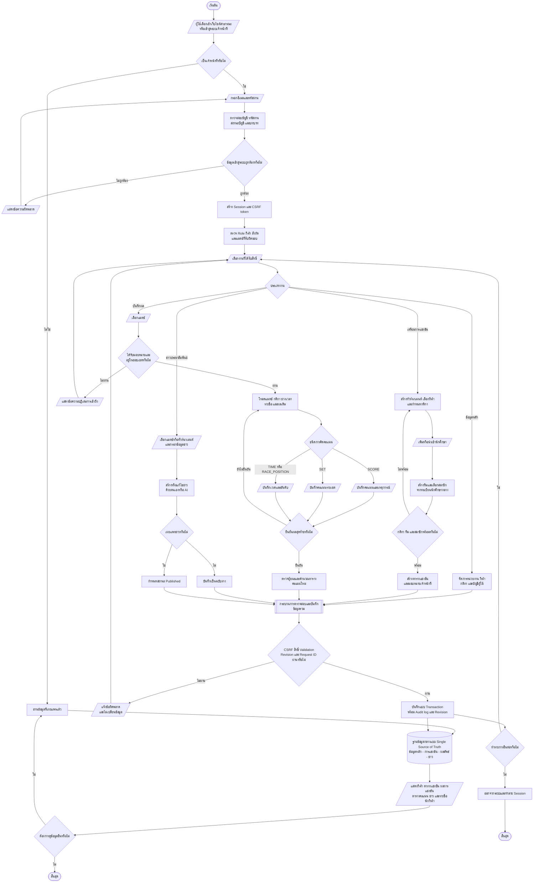

# Flowchart ระบบ TECHED SPORT ตามสัญลักษณ์มาตรฐาน

แผนภาพนี้ใช้สัญลักษณ์ตามหลักการเขียน Flowchart และรวมขั้นตอนที่ใช้ร่วมกันไว้เพียงจุดเดียว เพื่อลดทั้งความซ้ำซ้อนของแผนภาพและความซ้ำซ้อนของข้อมูลในระบบ

## ความหมายของสัญลักษณ์

| สัญลักษณ์ | ชื่อ | การใช้งานในแผนภาพ |
|---|---|---|
| วงรี | Terminator | จุดเริ่มต้นและสิ้นสุด |
| สี่เหลี่ยมด้านขนาน | Input / Output | การกรอก เลือก รับ หรือแสดงข้อมูล |
| สี่เหลี่ยมผืนผ้า | Process | ขั้นตอนประมวลผลหรือการทำงาน |
| สี่เหลี่ยมผืนผ้าขอบคู่ | Predefined process | กระบวนการย่อยที่เรียกใช้ร่วมกันหลายจุด |
| สี่เหลี่ยมข้าวหลามตัด | Decision | ตรวจเงื่อนไขและแยกเส้นทาง ใช่/ไม่ใช่ |
| ทรงกระบอก | Database | ฐานข้อมูลกลางของระบบ |
| ลูกศรทึบ | Flow line | ลำดับการทำงาน |

## หลักการลดความซ้ำซ้อนของข้อมูล

1. เก็บนักศึกษาหนึ่งครั้งใน `students` และใช้ `team_members` เชื่อมเข้าทีม
2. เก็บกีฬาและกติกาใน `sports` และ `sport_rule_versions` แล้วอ้างอิงด้วย ID
3. เก็บทีมหนึ่งครั้ง แล้วให้แมตช์อ้างอิงผ่าน `team1_id` และ `team2_id`
4. เก็บผลรวมหนึ่งระเบียนต่อแมตช์ใน `match_results`; ประวัติการแก้ไขแยกเก็บในตาราง revision
5. ใช้ `match_events` เป็นแหล่งเหตุการณ์จริง และคำนวณคะแนนหรือตารางอันดับจากผลที่ยืนยันแล้ว
6. ข่าวอ้างอิงรายการแข่งขันหรือแมตช์ผ่าน `news_links` แทนการคัดลอกข้อมูลต้นทาง
7. ทุกการเขียนข้อมูลผ่านจุดตรวจสอบและ Transaction กลางชุดเดียวกัน

> หมายเหตุ: หน้าบันทึกผลเฉพาะทางในระบบปัจจุบันมีสำหรับ `SCORE` และ `SET`; ชนิด `TIME` และ `RACE_POSITION` ใช้กระบวนการรายการผู้เข้าแข่งขันและ API ที่เกี่ยวข้อง
